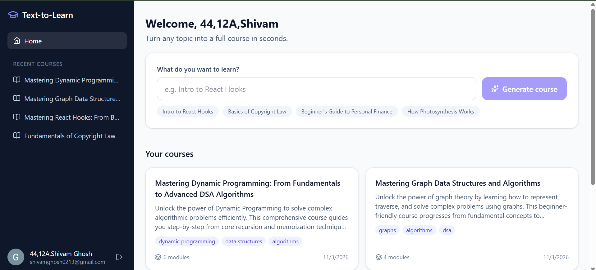
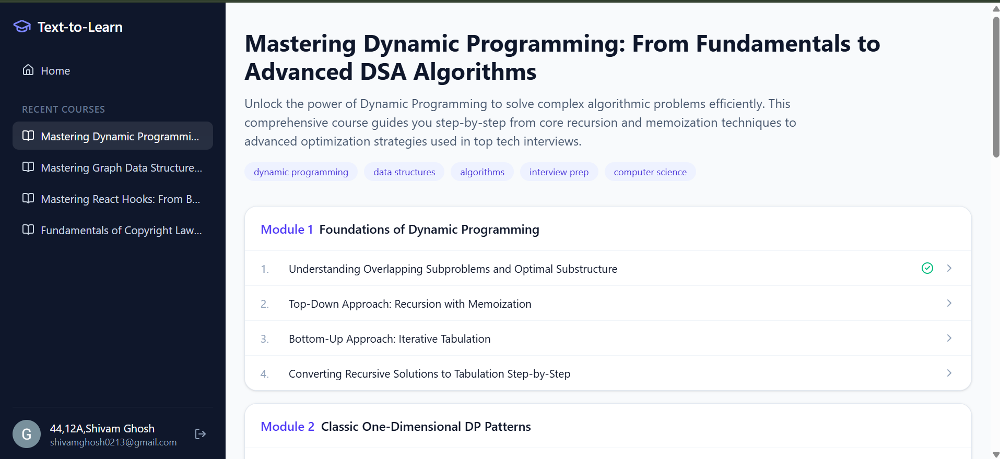
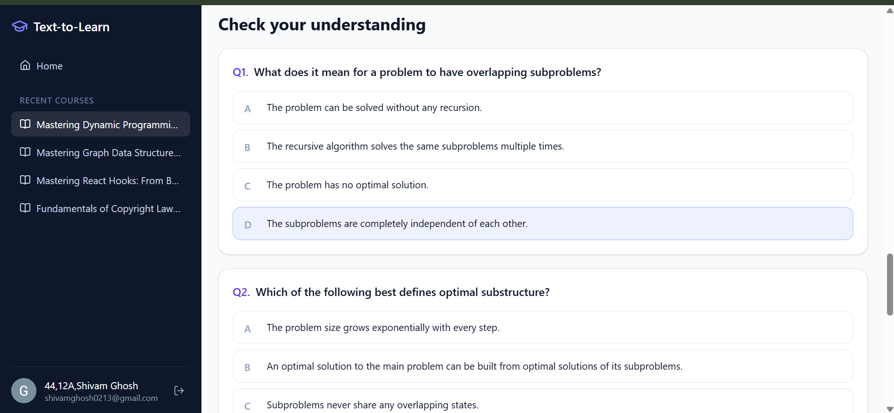
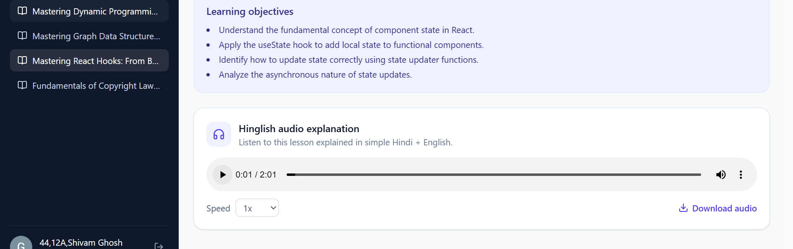
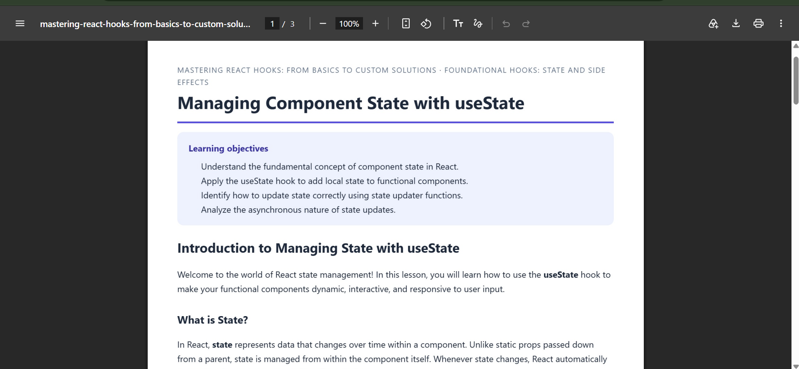
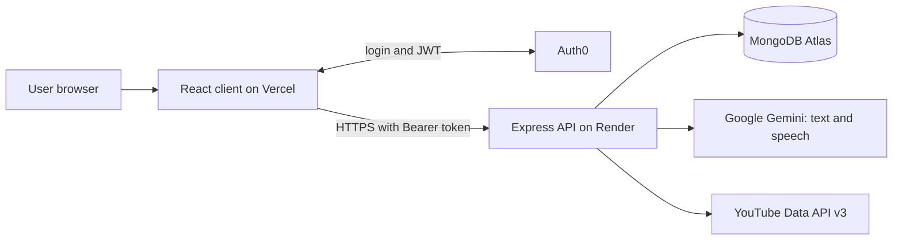
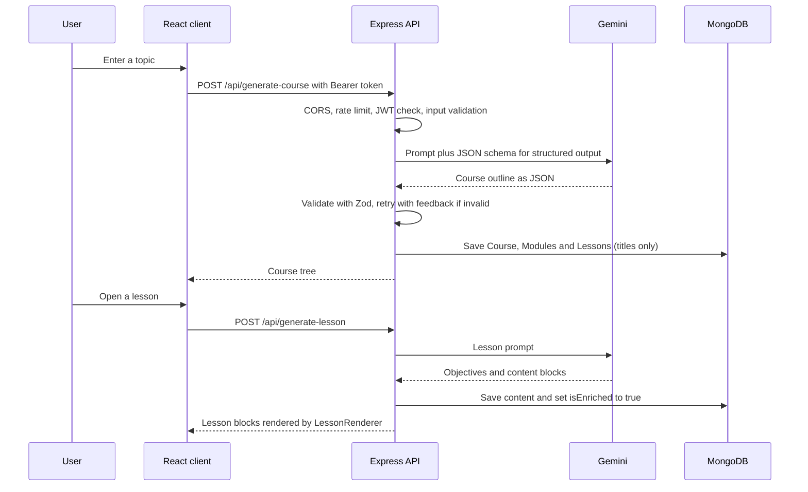

# Text-to-Learn: AI-Powered Course Generator

> Type any topic. Get a complete, structured course in seconds.


Text-to-Learn turns a free-form prompt such as "Intro to React Hooks" or "Basics of Copyright Law" into a complete online course: a title and description, 3 to 6 modules, and 3 to 5 lessons per module. Each lesson has learning objectives, explanations, syntax-highlighted code, an embedded YouTube video, a quiz, Hinglish audio narration and a downloadable PDF.

## Live demo

| | Link |
|---|---|
| Web app | https://text-to-learn-zeta.vercel.app |
| API health check | https://text-to-learn-api-2svq.onrender.com/api/health |
| Demo video (5 min) | [Watch on YouTube](ADD_YOUR_VIDEO_LINK_HERE) |

> The backend runs on a free Render instance that sleeps after 15 minutes without traffic. If the first request is slow, wait up to a minute while it wakes up. After that, everything is fast.

## Screenshots

| Home and prompt | Course syllabus |
|---|---|
|  |  |

| Lesson with video and code | Quiz and score |
|---|---|
|  |  |

| Hinglish audio player | PDF export |
|---|---|
|  |  |

## Features

| Feature | What it does |
|---|---|
| Prompt to Course | Enter a topic and get a structured course outline (3-6 modules, 3-5 lessons each), saved to your account |
| Rich Lessons | Objectives, headings, explanations, syntax-highlighted code with a copy button, and a YouTube video per lesson |
| Interactive Quiz | 4-5 multiple-choice questions per lesson with instant feedback, explanations and a final score |
| Hinglish Audio | The lesson is rewritten in simple Hindi + English and read aloud with Gemini text-to-speech (speed control and download) |
| Download as PDF | A clean, light-themed A4 PDF of the lesson with the quiz answers, with page breaks that never cut a block in half |
| Secure Login | Auth0 (OAuth 2.0 / OIDC) with refresh tokens; each user only sees their own courses |
| Persistent Courses | Courses are stored in MongoDB; lessons are generated on first open and then saved |
| Responsive UI | Sidebar layout that becomes a drawer on mobile, loading and error states everywhere |

## How it works





## Engineering highlights

- **Structured output plus validation.** Gemini is forced to answer in a JSON schema, and every response is validated again with Zod (module and lesson counts, exactly one video block, 4-5 quiz questions, valid answer indexes). Invalid output is retried with the exact validation error fed back to the model.
- **Built for flaky APIs.** Per-call timeouts, a total time budget, exponential backoff with jitter, and an optional fallback model keep generation reliable when the AI service is busy.
- **Lazy lesson generation.** Only the outline is generated up front. A lesson is written the first time it is opened and saved with an `isEnriched` flag, which cuts AI cost and time. Concurrent requests for the same lesson share a single generation.
- **Caching in MongoDB.** YouTube lookups (30 days) and generated audio (14 days) are cached with TTL indexes, which protects the daily API quota and makes repeat visits instant.
- **Security by default.** Auth0 JWT verification (RS256, issuer and audience checks), per-user ownership checks on every course and lesson, request validation, rate limiting (stricter on AI routes), a CORS allow-list, and secrets that never reach the browser.
- **Safe rendering.** AI text is rendered as text (bold and inline code are parsed, never injected as HTML). Prompts wrap user input in tags and tell the model to treat it as data.
- **Block-aware PDF export.** `html2canvas-pro` and `jsPDF` (lazy-loaded) render a hidden print layout, and page breaks are chosen between blocks so headings are never stranded.
- **Clean architecture.** routes, controllers, services, middlewares, models and schemas are separate layers. Controllers never touch AI or database details, and services never touch `req` or `res`.

## Tech stack

| Layer | Technology |
|---|---|
| Frontend | React (Vite), Tailwind CSS v4, React Router, TanStack Query, Axios, Lucide icons, highlight.js |
| PDF export | jsPDF, html2canvas-pro |
| Auth | Auth0 (React SDK on the client, `express-oauth2-jwt-bearer` on the server) |
| Backend | Node.js 22, Express 5, Mongoose, Zod, express-rate-limit |
| Database | MongoDB Atlas |
| AI | Google Gemini via `@google/genai` (text generation and text-to-speech) |
| Video | YouTube Data API v3 |
| Hosting | Render (backend), Vercel (frontend) |
| CI/CD | GitHub Actions, automatic deploys on merge to `main` |

## Project structure

```
text-to-learn/
├── .github/workflows/ci.yml
├── client/
│   ├── vercel.json                  # SPA rewrite so deep links work
│   └── src/
│       ├── components/              # Sidebar, PromptForm, LessonRenderer, HinglishAudioPlayer, ...
│       │   ├── blocks/              # Heading, Paragraph, Code, Video, MCQ blocks
│       │   └── pdf/                 # PdfLesson layout and LessonPdfExporter
│       ├── context/                 # Auth0ProviderWithNavigate
│       ├── hooks/                   # TanStack Query hooks
│       ├── pages/                   # Auth, Home, Course, Lesson, NotFound
│       └── utils/                   # api client, pdfExport
└── server/
    ├── server.js                    # entry point
    ├── config/                      # db and Gemini client
    ├── routes/                      # URL to controller mapping
    ├── controllers/                 # request and response handling
    ├── services/                    # AI, course, lesson, YouTube, narration, TTS, audio
    ├── middlewares/                 # auth, validation, rate limiting, error handler
    ├── models/                      # Course, Module, Lesson, VideoCache, LessonAudio
    ├── schemas/                     # Gemini response schemas and Zod validators
    ├── scripts/testAI.js            # test AI generation without any route
    └── utils/                       # errors, asyncHandler, cleanJson, wav
```

## API reference

Base URL: `https://text-to-learn-api-2svq.onrender.com`. Every route except the health check needs `Authorization: Bearer <access_token>`.

| Method | Endpoint | Purpose |
|---|---|---|
| GET | `/api/health` | Uptime check (public) |
| POST | `/api/generate-course` | Topic in, saved course outline out |
| GET | `/api/user-courses` | List the signed-in user's courses |
| GET | `/api/courses/:id` | One course with modules and lesson titles |
| DELETE | `/api/courses/:id` | Delete a course and its modules and lessons |
| POST | `/api/generate-lesson` | Generate (or return saved) content for one lesson |
| GET | `/api/lessons/:id` | Fetch a lesson |
| GET | `/api/youtube?query=` | Find an embeddable video for a search query (cached) |
| POST | `/api/lessons/:id/audio` | Hinglish narration as `audio/wav` (cached) |

Errors always use one shape:
```json
{ "success": false, "error": { "code": "VALIDATION_ERROR", "message": "Invalid request" } }
```

## Data model

| Entity | Key fields | Relationship |
|---|---|---|
| Course | title, description, tags, creator (Auth0 `sub`) | has many Modules |
| Module | title, course | belongs to a Course, has many Lessons |
| Lesson | title, objectives, content blocks, isEnriched | belongs to a Module |
| VideoCache | query, videoId, title | TTL 30 days |
| LessonAudio | lesson, Hinglish script, WAV audio | TTL 14 days |

Lesson content is an ordered array of blocks: `heading`, `paragraph`, `code`, `video` (a search query, never a hard-coded link) and `mcq`.

## Run it locally

**Prerequisites:** Node.js 20 or newer, a MongoDB Atlas cluster, an Auth0 tenant, a Google AI (Gemini) API key and a YouTube Data API v3 key.

```bash
git clone https://github.com/ghoshshivam/text-to-learn.git
cd text-to-learn

# Backend
cd server
npm install
cp .env.example .env        # then fill in the values
npm run dev                 # http://localhost:5000

# Frontend (new terminal)
cd client
npm install
cp .env.example .env        # then fill in the values
npm run dev                 # http://localhost:5173
```

**Auth0 setup**

1. Create an **API** with the identifier `https://text-to-learn-api` and switch on **Allow Offline Access**.
2. Create a **Single Page Application** and set Allowed Callback URLs, Allowed Logout URLs and Allowed Web Origins to `http://localhost:5173`.
3. Under the application's **API Access** tab, authorize it for your API (user access).

**Environment variables**

| Server (`server/.env`) | Purpose |
|---|---|
| `MONGO_URI` | MongoDB connection string |
| `AUTH0_ISSUER` | `https://<tenant>.auth0.com/` (keep the trailing slash) |
| `AUTH0_AUDIENCE` | Your API identifier |
| `CLIENT_ORIGIN` | Allowed frontend origin(s), comma separated |
| `GEMINI_API_KEY` | Gemini key |
| `GEMINI_MODEL`, `GEMINI_FALLBACK_MODEL` | Text model and optional fallback |
| `GEMINI_THINKING_LEVEL` | `low` keeps generation fast |
| `GEMINI_TTS_MODEL`, `GEMINI_TTS_VOICE`, `GEMINI_TTS_LANGUAGE` | Text-to-speech settings |
| `YOUTUBE_API_KEY` | YouTube Data API v3 key |
| `AUTH_DISABLED` | `true` only for local API testing, ignored in production |

| Client (`client/.env`) | Purpose |
|---|---|
| `VITE_AUTH0_DOMAIN` | Auth0 domain without `https://` |
| `VITE_AUTH0_CLIENT_ID` | Auth0 application client ID |
| `VITE_AUTH0_AUDIENCE` | Same value as the server audience |
| `VITE_API_URL` | Backend URL, for example `http://localhost:5000` |

Test the AI layer on its own, without any route or login:

```bash
cd server
npm run test:ai -- "Basics of Copyright Law"
```

## Deployment

- **Backend on Render:** root directory `server`, build `npm install`, start `npm start`, health check `/api/health`, plus the server variables above and `NODE_ENV=production`, `NODE_VERSION=22`.
- **Frontend on Vercel:** root directory `client`, framework Vite, plus the four `VITE_` variables (set as plain config values, not secrets). `client/vercel.json` rewrites all paths to `index.html`.
- **Auth0:** add the Vercel URL to Allowed Callback URLs, Allowed Logout URLs and Allowed Web Origins.
- **MongoDB Atlas:** allow Render's outbound traffic in Network Access.
- **CI/CD:** GitHub Actions installs dependencies, syntax-checks the server, lints and builds the client on every push and pull request. Merging to `main` triggers automatic deploys on Render and Vercel.

## Development workflow

Every feature was built on its own branch and merged through a pull request, with small, descriptive commits: backend setup, database models, AI service, API routes, Auth0 and frontend, lesson renderer, PDF export, Hinglish audio, deployment and CI. See the [Pull requests](../../pulls?q=is%3Apr) tab for the full history.

## Known limitations

- The free Render instance sleeps when idle, so the first request after a break can take about a minute.
- YouTube allows roughly 100 uncached searches per day on the default quota, which is why results are cached.
- The Gemini text-to-speech model is in preview, so model names and rate limits can change.
- The PDF is generated from an image, so its text cannot be selected.
- AI-generated lessons can contain mistakes. Treat them as a starting point and verify important facts.

## Roadmap

- Track quiz scores and lesson progress per user
- Export a whole course as one PDF
- More narration languages (pure Hindi, Tamil and others) and a voice picker
- Share a course through a public link
- Automated API tests with Jest and Supertest

## Author

Built by **Shivam Ghosh** ([@ghoshshivam](https://github.com/ghoshshivam)) for the Text-to-Learn hackathon challenge.